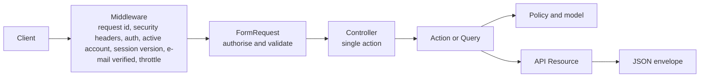

# Platform Assurance

**How this starter is built, what it protects, and how every change is verified.**

| Item             | Detail                                                                                     |
| ---------------- | ------------------------------------------------------------------------------------------ |
| Document Version | 1.0.0                                                                                      |
| Last Reviewed    | 19 November 2026                                                                           |
| Scope            | The Laravel JSON API starter in this repository                                            |
| Evidence Base    | Release `v4.0.2` (19 November 2026), plus the CI gates in `.github/workflows/ci.yml`       |
| Owner            | Ben Belmour, Engineering                                                                   |

This document is the measured story for reviewers. The engineering rules behind it live in
[security-engineering-standards.md](security-engineering-standards.md). Figures are
measured from the tagged release named above, not estimated; re-run the gates in
[testing.md](testing.md) for current numbers.

> [!TIP]
> Security review starts at
> [security-engineering-standards.md](security-engineering-standards.md). This page explains
> what ships and what does not, in plain language.

## In Short

This repository is a **starter template** for a Laravel JSON API, not a finished product.
It demonstrates a server-side pattern that a team can copy into a greenfield API: Sanctum
authentication, Spatie roles and permissions, invokable controllers, FormRequests,
Policy-based authorisation, query classes for sort, filter, include, and sparse fieldsets,
API Resources, an append-only authentication audit trail, rate limiting, webhooks with an
SSRF guard, and a CI pipeline that blocks a merge when any gate fails.

The API is server-rendered JSON only. There is no first-party browser application holding
business rules, so every control described here is enforced on the server. The suite that
proves it runs on every proposed change.

None of that is asserted on trust. At `v4.0.2` the suite ran **1,465 tests** with
**93.11%** line coverage against a **90%** floor, and thirteen independent CI jobs had to
pass before the release tag was cut. The figures and the deferred scope are named below.

## At a Glance

| Measure                        | Figure                                                                            |
| ------------------------------ | --------------------------------------------------------------------------------- |
| Automated tests per change     | **1,465** PHPUnit tests                                                           |
| Server code coverage           | **93.11%** line coverage (5,472 of 5,877 statements), against a **90%** minimum   |
| Blocking CI jobs               | **13**, plus the **All Quality Gates** summary job                                |
| Static analysis                | **Larastan level 10**, the maximum PHPStan supports, with strict and deprecation rules |
| Security code scanning         | **Semgrep** on every change (404 rules, 0 findings at `v4.0.2`)                   |
| Workflow supply-chain audit    | **Zizmor** on every change                                                        |
| Dependency audits              | **2** per change: `composer audit` and production-only `npm audit`                 |
| Rate limiters guarding the API | **17** named limiters                                                             |
| Permissions and roles          | **34** permissions across **4** roles                                             |
| Authentication audit events    | **34** named events                                                               |
| Password hashing               | **Argon2id**, 64 MiB, 4 iterations, breach-checked                                |
| Signed-in device control       | **Active Sessions**: list, show, revoke one, revoke others                        |
| Vulnerability reporting path   | `SECURITY.md` plus `/.well-known/security.txt` (RFC 9116)                          |
| Browser application            | None shipped; the API reference is Scalar, authenticated                         |
| Deployment workflow            | None shipped; the operator owns deploy, TLS, backups, and secret management        |

## What This Project Is

- A **starter template** that demonstrates one consistent way to build a resource:
  route, FormRequest, Policy, Action or Query, API Resource, and tests.
- An **API-only** application. The human-facing surface is the welcome page, the
  authenticated Scalar reference, and the RFC 9116 security.txt file.
- A **query-driven** API: every list endpoint follows the same `sort`, `filter`, `include`,
  `fields`, and pagination contract, with allow-lists in `*QueryConstraints` classes.
- A **fully wired reference** for Users, Roles, Teams, API Tokens, API Clients, Web
  Sessions, Auth Audit Logs, and Webhooks.
- A **tested security posture**: server-side authorisation, rate limiting, an SSRF guard
  for webhooks, security headers, and a CI pipeline that blocks a merge on failure.

## What It Is Not

- It is not a product, a multi-tenant platform, or a deployment pipeline.
- It does not ship a browser SPA. There is no Vue, React, Playwright, or accessibility
  matrix here.
- It does not ship authenticator-app TOTP, SMS codes, Passkeys, social sign-in, step-up
  re-authentication, or impersonation. Two-factor authentication is email OTP, opt-in per
  account.
- It does not provide organisation-level tenancy. Row scoping is by Team.
- It does not provide audit-log retention, backups, log shipping, or host hardening. Those
  are deployment responsibilities.
- It does not claim an SLA, a compliance certification, or a formal security policy.

## Architecture

A request passes through the same layers on every endpoint:

The pattern is the control. A controller does one thing; a FormRequest owns validation and
delegates authorisation to a Policy; an Action owns a write, a Query owns a read; an API
Resource shapes the response. The shared envelope comes from
[ApiResponse](../app/Support/ApiResponse.php).

## Authentication and Sessions

The starter supports two authentication modes against the same User store:

| Mode | Use | Details |
| --- | --- | --- |
| Bearer token | Machine and mobile clients | Sanctum Personal Access Tokens, configurable expiry and maximum lifetime |
| Cookie session | Same-origin browser clients | Sanctum stateful session, CSRF, device registry |

Passwords use Argon2id (64 MiB, 4 iterations), require 12 characters with mixed case and
numbers, and are rejected if they appear in the Have I Been Pwned corpus. Login is rate
limited on the e-mail plus IP, the e-mail alone, and the IP.

Sessions rotate at sign-in. A `session_version` stamp invalidates every session on password
reset, suspension, and force-logout. The session cookie takes the `__Host-` prefix when it
is `Secure`, host-only, and scoped to `Path=/`. Account holders can list and revoke devices.

E-mail verification gates the business routes. The identity endpoints (`resend`, `logout`,
`me`) remain reachable so an unverified account can verify and sign out. Service accounts
pass because they authenticate with client credentials and have no mailbox.

Two-factor authentication is email OTP, opt-in per account. The code defaults to a
300-second lifetime and at most 5 attempts, and is carried by a stateless pending token. Machine clients use
the OAuth2 client-credentials grant with RFC 6749 error bodies.

## Authorisation and Team Scoping

Authorisation is server-side and permission-based. Thirty-four named permissions are seeded
across four roles:

| Role | Shape |
| --- | --- |
| Admin | Full directory, roles, API clients, audit logs, webhooks, sessions, tokens |
| Manager | Own-Team directory and limited updates |
| User | Self-service profile, tokens, permissions list, own sessions |
| Service | Machine identity for client credentials; directory reads, no mailbox or audit trail |

Policies decide access. Out-of-scope reads return `404`, not `403`, so existence cannot be
probed. Permission denials on a write return `403`. The audit log is Admin only, and the
Policy rejects service accounts even if a permission is mis-assigned.

Team scoping is applied in the Filter Query before optional filters run. An Admin may list
across Teams through `users.list-all`; a Manager sees the Team on their User row; a User
cannot list users. The client never supplies the Team id. The source of truth is
[UserFilterQuery](../app/Queries/Users/UserFilterQuery.php) and
[permissions.md](permissions.md).

## Audit and Observability

- **Auth audit trail:** append-only `auth_audit_logs`, written on a queue, covering login,
  logout, 2FA, password change and reset, registration, session revoke, token and API
  client lifecycle, webhook endpoint lifecycle, role changes, and suspension. Each row
  carries the outcome, request id, IP, parsed user agent, and approximate location.
- **Request correlation:** every response carries an `X-Request-ID`, accepted from the
  caller or generated, and the same id is threaded through logs and audit rows.
- **Health and status:** `GET /health` probes the database; `GET /api/status` reports the
  recorded component history; `GET /api/app-info` publishes non-sensitive runtime metadata
  for deploy verification.
- **CSP reports:** violations land in a dedicated `csp-reports` log channel, capped per
  request, never in the main log.
- **Debug tooling:** Telescope is gated to Admin and local only.

Retention is deliberately not invented here. Expired Sanctum tokens are pruned on a
schedule; audit-log retention is a deployment decision.

## Data Protection and Retention

The starter stores the data a directory and authentication system needs:

| Data | Where | Retention in this repository |
| --- | --- | --- |
| Users, Teams, roles, permissions | MySQL | Until deleted or restored |
| Web sessions and remember tokens | MySQL | Until revoked, rotated, or pruned by the application |
| Personal access tokens | MySQL | Expired tokens pruned by `sanctum:prune-expired` |
| Auth audit rows | MySQL | No prune command shipped; deployment decision |
| Webhook deliveries and endpoints | MySQL | Until deleted or auto-disabled |
| CSP reports | Log file | Log rotation, not database retention |

Secrets are environment-supplied. `.env` is ignored; `.env.example` and `.env.ci` carry
non-sensitive defaults only. Logs must not contain passwords, OTP codes, reset tokens, or
session ids. Backups, encryption at rest, and cross-region copies are the operator's
responsibility, not something this repository claims.

## Supply Chain and Secure Development

- Dependencies are locked and installed from the lock files. No `vendor` tree is committed.
- `composer audit` and production-only `npm audit` block a merge on advisories.
- Semgrep scans application code; Zizmor audits the workflows; Hadolint and ShellCheck
  cover the Dockerfile and shell scripts.
- Base images are pinned by digest; third-party GitHub Actions are pinned to full commit
  SHAs with the tag kept as a comment.
- The PHP CVE floor, PHP version parity, service parity, and application version are gated
  in CI.
- Dependabot and Renovate propose updates through the same review and test cycle as any
  feature. A dependency bump that skips CI is not merged.

## Controlled Releases

Releases are cut from a green commit, not from a branch tip that merely looks current:

1. Bump the version in `composer.json`, `docs/openapi.yaml`, `.env.example`, `.env.ci`, and
   the changelog.
2. Run the local gates and refresh the lock hash.
3. Push to `main` and wait for **All Quality Gates** to pass on that commit.
4. Tag `vX.Y.Z` after verifying the tag points at that commit, then push the tag.
5. Publish the GitHub release from the generated notes.

The full procedure is [releasing.md](releasing.md). This repository ships no staging or
production deploy workflow: a consumer adds its own environment promotion, and the tag is
the hand-off point.

## How Every Change Is Verified

Every proposed change runs the same blocking jobs. The summary job, **All Quality Gates**,
fails when any job fails, is cancelled, or is skipped.

| Job | What It Proves | Local Command |
| --- | --- | --- |
| Pint | Formatting and version sync | `composer lint` |
| Link Check | Relative links and heading anchors resolve | `composer lint:links` |
| Frontend Build | The Vite build succeeds | `npm run build` |
| Larastan (Level 10) | Maximum static analysis | `composer analyse` |
| PHPUnit + Coverage | Suite passes; 90% line floor over `app/` | `composer test:coverage:check` |
| Security Audit | Composer and production npm advisories | `composer audit --locked`, `npm run audit:prod` |
| OpenAPI Examples | Documented examples replay against a served, seeded app | `composer verify:openapi` |
| Semgrep | No insecure PHP, Laravel, or Actions pattern | `bash scripts/semgrep.sh` |
| Zizmor | Workflow supply-chain policy | `bash scripts/run-zizmor.sh` |
| Hadolint | Dockerfile lint | `bash scripts/run-hadolint.sh` |
| Base Image References | Digest-pinned images resolve | `python3 scripts/lint/check-base-image-refs.py` |
| ShellCheck | Shell scripts lint | `bash scripts/run-shellcheck.sh` |
| Lint Workflows | `actionlint` and runner labels | `bash scripts/run-actionlint.sh` |

`composer ci` chains the PHP and JavaScript gates that can run inside Sail. The host
scanners need Docker or a local CLI and are listed separately in [testing.md](testing.md).
At `v4.0.2` the suite ran 1,465 tests with 93.11% coverage against the 90% floor.

## Performance and Scale

The API is designed to stay predictable as a directory grows:

- Pagination is capped per resource by its `*QueryConstraints` class; a caller cannot ask
  for an unbounded page.
- Sort, filter, include, and sparse-fieldset allow-lists live in those constraints, so a
  request cannot widen a query or select an arbitrary column.
- Search terms go through [LikePattern](../app/Support/LikePattern.php) to keep wildcards
  from changing the query shape.
- Rate-limit counters require a shared cache store for multi-instance correctness; the
  example environment uses Redis.
- Audit writes, webhook deliveries, and notifications are queued, so sign-in and writes do
  not wait on mail or GeoIP.
- Health checks separate liveness (`/health`) from recorded component history
  (`/api/status`).

The trade-offs are recorded in [performance.md](performance.md).

## Known Limits and Deferred Scope

These are named so a reviewer does not discover them the hard way. Each is a deliberate
limit of a starter, not an accident.

| Topic | Current Behaviour | Why It Is Named |
| --- | --- | --- |
| MFA channels | Email OTP only, opt-in; no TOTP, SMS, Passkeys, or social sign-in | A product adds channels behind the same contract |
| Step-up and impersonation | Not shipped | Product features, not starter defaults |
| Tenancy | Team row scoping, not organisation tenancy | A product may add a second scope |
| Audit retention | No prune command; deployment decision | Compliance window belongs to the operator |
| Trusted proxies | Process environment only; `.env` alone is ignored | Resolved before the config binding exists |
| Webhook SSRF | Delivery-time re-screen; narrow DNS rebinding race remains | Closing it means pinning the screened IP |
| CSP | No nonce; Scalar has its own policy with inline styles | No first-party inline script exists |
| App info | Public runtime metadata by design | Deploy verification needs it |
| Deployment | No staging or production workflow | The operator owns deploy and hardening |
| Browser testing | No SPA, no Playwright | There is no first-party browser app to drive |

## Technical Appendix

The implementation is the source of truth. These are the files a reviewer should read
before this document.

| Concern | Source of Truth |
| --- | --- |
| Routes and middleware stack | [routes/api.php](../routes/api.php), [routes/web.php](../routes/web.php), [bootstrap/app.php](../bootstrap/app.php) |
| Authentication and MFA | [app/Actions/Auth/](../app/Actions/Auth/), [app/Http/Controllers/Auth/](../app/Http/Controllers/Auth/) |
| Permissions and roles | [RolesAndPermissionsSeeder](../database/seeders/RolesAndPermissionsSeeder.php), [app/Policies/](../app/Policies/) |
| Team row scoping | [UserFilterQuery](../app/Queries/Users/UserFilterQuery.php), [UserQueryConstraints](../app/Queries/Users/UserQueryConstraints.php) |
| Rate limiters | [AppServiceProvider](../app/Providers/AppServiceProvider.php), [config/api.php](../config/api.php) |
| Security headers and CSP | [SecurityHeaders](../app/Http/Middleware/SecurityHeaders.php), [config/security.php](../config/security.php) |
| CORS | [config/cors.php](../config/cors.php) |
| Trusted proxies | [TrustedProxies](../app/Support/TrustedProxies.php) |
| Audit trail | [RecordAuthAuditLog](../app/Listeners/RecordAuthAuditLog.php), [AuthAuditLogPolicy](../app/Policies/AuthAuditLogPolicy.php) |
| Webhook SSRF guard | [WebhookUrlGuard](../app/Services/Webhooks/WebhookUrlGuard.php) |
| CSP reports | [LogCspReportAction](../app/Actions/CspReports/LogCspReportAction.php) |
| CI gates | [.github/workflows/ci.yml](../.github/workflows/ci.yml) |
| Coverage floor | [check-coverage-threshold.php](../scripts/check-coverage-threshold.php) |
| Version sync | [verify-app-version.php](../scripts/verify-app-version.php) |
| Disclosure | [SECURITY.md](../SECURITY.md), [security.txt](../public/.well-known/security.txt) |

## Related Documents

| Doc | Use |
| --- | --- |
| [security-engineering-standards.md](security-engineering-standards.md) | The engineering contract behind this page |
| [SECURITY.md](../SECURITY.md) | Responsible disclosure contact and response targets |
| [permissions.md](permissions.md) | Permission and role matrix |
| [rate-limiting.md](rate-limiting.md) | Limiters, key shapes, counter storage |
| [testing.md](testing.md) | Quality gates and how to run them |
| [releasing.md](releasing.md) | Release procedure and tag rules |
| [performance.md](performance.md) | Pagination and search trade-offs |
| [openapi.yaml](openapi.yaml) | Machine-readable API contract |
| [api.md](api.md) | Scalar setup and spec sync checklist |
