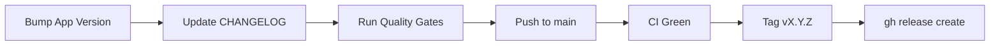

# Releasing Laravel API Skeleton

How to cut a release of **this** repo, in order, with the check that proves each
step. Written to be followed literally by a human or an agent.

For GitHub release note formatting (emoji section headings, **Full Changelog**
footer), follow the **create-github-release** skill in your conventions toolkit.
This runbook is the surrounding procedure - gates, changelog, tag, and publish.

- **Prerequisites:** `gh` authenticated against `Aontaigh/laravel-api-skeleton`
  (`gh auth status`); push access to `main`; Docker for Sail when host PHP is not 8.5.
- **Versioning:** semver. New endpoints or conventions are a **minor**; docs, test
  refactors, and dependency patches are a **patch**; breaking API or convention changes
  are a **major**.

## Release Checklist

- [ ] 1. App version bumped - `composer.json`, `docs/openapi.yaml`, `.env.example` / `.env.ci`, and changelog (see [App version](#app-version)), then `composer update --lock` so the lock's content hash matches
- [ ] 2. `CHANGELOG.md` updated - `## [X.Y.Z] - YYYY-MM-DD` with today's date
- [ ] 3. Quality gates green locally (see below), with the link gate's in-flight compare
      exemptions updated for the release being cut (see [Run the Quality Gates](#2-run-the-quality-gates))
- [ ] 4. Release commit pushed to `main`, CI green **on that commit**
- [ ] 5. Tag `vX.Y.Z` on the CI-green commit and push
- [ ] 6. GitHub release published per [GitHub release format](#github-release-format) (emoji
      section headings, unwrapped bullets, **Full Changelog** footer - do not paste
      `CHANGELOG.md` verbatim)

## Release Flow



## App Version

The `/health` endpoint reports the app version from `config('app.version')`. That
value defaults to the **`version` field in `composer.json`** - not a hard-coded
fallback in `config/app.php`. Keep these in sync on every release:

| File                                                          | What to Update                                                                                                                                               |
| ------------------------------------------------------------- | ------------------------------------------------------------------------------------------------------------------------------------------------------------ |
| [`composer.json`](../composer.json)                           | `"version": "X.Y.Z"` - **source of truth**                                                                                                                   |
| [`docs/openapi.yaml`](../docs/openapi.yaml)                   | `info.version`, the `HealthSuccess` example, and the `HealthData.version` schema example                                                                     |
| [`.env.example`](../.env.example) and [`.env.ci`](../.env.ci) | Commented `# APP_VERSION=X.Y.Z` placeholder in the Application section (documents the optional override; keep in sync with `composer.json` on every release) |
| Git tag                                                       | `vX.Y.Z` (must match composer version without the `v` prefix)                                                                                                |

`APP_VERSION` in `.env` is an optional override for deployed environments. Local
dev and CI do not need it when `composer.json` is current. The commented
placeholder in `.env.example` is operator documentation only - it is not
enforced by CI, so update it manually when bumping the version.

CI enforces sync via `composer verify:version` (also part of `composer ci`):

```bash
./vendor/bin/sail composer verify:version
# or: ./vendor/bin/sail php scripts/verify-app-version.php
```

The script fails when OpenAPI drifts from `composer.json`, or when a tagged GitHub
Actions build (`GITHUB_REF_NAME=vX.Y.Z`) does not match the composer version.

### Refresh the Lock Hash

Bumping `version` edits `composer.json`, and Composer's `content-hash` covers that
field, so the bump also makes `composer.lock` stale. Refresh it in the same commit:

```bash
./vendor/bin/sail composer update --lock
```

`composer update --lock` rewrites the hash without changing a single locked version.
`composer lint:composer` (step 1a in [testing.md](testing.md), and part of `composer ci`)
fails on a stale hash, so CI catches a bump that forgot this step.

## 1. Update the Changelog

`CHANGELOG.md` follows [Keep a Changelog](https://keepachangelog.com/en/1.1.0/).
Rename `## [Unreleased]` to `## [X.Y.Z] - YYYY-MM-DD`, add a fresh empty
`## [Unreleased]` above it, and update the footer compare links at the bottom.

Use **plain** section headings in this file (`### Added`, `### Changed`) - emoji
headings are for the GitHub release only.

## 2. Run the Quality Gates

> [!IMPORTANT]
> Discover commands from this repo - do not assume another project's gates. Primary
> sources: [`.github/workflows/ci.yml`](../.github/workflows/ci.yml) and `composer.json`
> scripts.

Local, in two halves - the PHP and JavaScript gates run through Sail, the Docker-backed
scanners on the host:

```bash
./vendor/bin/sail artisan migrate:fresh --seed --force
./vendor/bin/sail composer lint
./vendor/bin/sail composer lint:composer
./vendor/bin/sail composer lint:links
./vendor/bin/sail npm run lint:npm
./vendor/bin/sail composer verify:php-version
./vendor/bin/sail composer verify:php-cve-floor
./vendor/bin/sail composer analyse
./vendor/bin/sail composer test:coverage:check
./vendor/bin/sail composer verify:version
./vendor/bin/sail composer audit --locked
./vendor/bin/sail composer verify:openapi

bash scripts/semgrep.sh
bash scripts/run-hadolint.sh
bash scripts/run-shellcheck.sh
bash scripts/run-zizmor.sh
bash scripts/run-actionlint.sh
```

Those Sail lines are what `composer ci` chains, minus `semgrep`. `./vendor/bin/sail
composer ci` cannot stand in for them: `ci` includes `@semgrep`, and `scripts/semgrep.sh`
needs a local Semgrep CLI or a Docker CLI, neither of which exists inside the app
container - it exits 1 with `Semgrep Is Not Installed`. The scanner wrappers need that
same Docker CLI, so all six scanner commands run on the host
([testing.md](testing.md) steps 7 to 10). OpenAPI verification replays every documented
example against a served, seeded app, so seed before running the chain.

See [README Quality Gates](../README.md#quality-gates) for the full command list and
Sail port notes when Docker ports on your machine are already in use.

The link gate exempts the two compare URLs for the release being cut - `v{prev}...v{new}` and
`v{new}...HEAD` - in [`scripts/lint-links.sh`](../scripts/lint-links.sh), because GitHub 404s a
compare until the tag exists on the remote. Add both before running the gates, and delete both
once the tag is pushed: a stale pair passes silently and hides the next release's dead links.

## 3. Commit and Push, Then Wait for CI

Stage the tree rather than a list of paths. When the feature work is already
committed, the release bump touches these files - the changelog, `composer.json`,
`composer.lock`, `docs/`, `.env.example`, `.env.ci`, and the link gate's in-flight
exemption pair:

```bash
git add -A
git status --porcelain
git commit -m "chore(release): prepare vX.Y.Z"
git push origin main
gh run watch --exit-status
```

`git status --porcelain` must print nothing. A hand-written path list is how
`composer.lock` goes missing: the bump edits `composer.json`, Composer's
`content-hash` covers that field, so `composer update --lock` rewrites the lock in
the same step - and a rewritten lock left unstaged still passes
`composer lint:composer` locally, because that gate reads the working tree, while
CI reads the commit and fails on the stale hash (`exit 2`, `# Lock file errors`).
Staging the tree removes that class rather than one instance of it, and it covers a
release carrying uncommitted feature work too: the tag must point at a commit
containing both the feature and the version bump, and a release-files-only commit
would let CI green-light a `main` that still lacks the feature.

Push and tag with the account that holds write access to the repository - the
publisher token needs push on `main` and release creation, so verify
`gh auth status` before step 3 rather than at the release step.

CI must be green on the commit you are about to tag. The **All Quality Gates** summary
job must pass - Pint (with app version sync), Link Check, Larastan, PHPUnit + coverage,
Security Audit, OpenAPI Examples, Semgrep, Zizmor, and Lint Workflows (`actionlint` and
the Renovate config).

## 4. Tag the CI-Green Commit

```bash
git fetch --tags origin
git rev-parse main            # note this SHA
git tag -a vX.Y.Z -m "Release vX.Y.Z"
git push origin vX.Y.Z
git rev-parse vX.Y.Z^{}       # the tagged commit, must equal the SHA above
```

> [!WARNING]
> Tag only after CI passes on **that** commit - not an earlier changelog-only push that
> failed a gate.

## 5. Publish the GitHub Release

Draft notes from the `## [X.Y.Z]` changelog section:

```bash
python3 scripts/changelog-to-github-release-body.py X.Y.Z > /tmp/release-notes.md
```

That renders the section in the format below - emoji headings, one physical line per bullet,
and the compare footer - so it is generated rather than assembled by hand. GitHub release
notes are **not** a copy of `CHANGELOG.md`: they follow a separate layout so they render
cleanly on the [Releases](https://github.com/Aontaigh/laravel-api-skeleton/releases) page.

### GitHub Release Format

| Rule             | `CHANGELOG.md`              | GitHub Release                                                 |
| ---------------- | --------------------------- | -------------------------------------------------------------- |
| Version heading  | `## [1.14.0] - 2026-09-11`  | **Omit** - the tag title (`v1.14.0`) is the heading            |
| Section headings | `### Added` (plain)         | `### ✅ Added` (emoji + Title Case)                            |
| Section headings | `### Changed`               | `### 🔄 Changed`                                               |
| Section headings | `### Fixed`                 | `### 🐛 Fixed`                                                 |
| Section headings | `### Removed`               | `### ❌ Removed`                                               |
| Footer           | Compare link in file footer | `**Full Changelog**` block at the end of the notes (see below) |

Use **only** the emoji section headings above. Do not publish plain `## Added` /
`## Changed` headings or paste the Keep a Changelog version line into the release body.

**Unwrap the bullets before publishing.** GitHub release notes preserve single newlines as
line breaks (they render like issue comments, not like READMEs), so pasting `CHANGELOG.md`'s
hard-wrapped lines verbatim re-wraps every bullet at the changelog's ~95-character column -
a ragged right edge that never extends to the container's full width. Join each bullet's
continuation lines into one flowing line per bullet (headings, blank lines, and the
`**Full Changelog**` footer stay on their own lines); GitHub then reflows each bullet to the
full container width.

Omit empty sections. Keep section order: Added, Changed, Fixed, Removed.

End every release **after `v1.0.0`** with a horizontal rule and compare link:

```markdown
---

**Full Changelog**: [vPREV...vX.Y.Z](https://github.com/Aontaigh/laravel-api-skeleton/compare/vPREV...vX.Y.Z)
```

The initial `v1.0.0` release has no prior tag, so it ends after the last bullet with no
footer.

### Example (Patch Release)

```markdown
### 🔄 Changed

- `.github/renovate.json` - `minimumReleaseAge` at root scope (Semgrep-compliant without per-rule exceptions)
- CI workflow-lint job validates Renovate config with `renovate-config-validator`

---

**Full Changelog**: [v1.14.0...v1.14.1](https://github.com/Aontaigh/laravel-api-skeleton/compare/v1.14.0...v1.14.1)
```

Reference: [v1.13.0](https://github.com/Aontaigh/laravel-api-skeleton/releases/tag/v1.13.0)
(minor with Added / Changed / Fixed) and
[v1.14.1](https://github.com/Aontaigh/laravel-api-skeleton/releases/tag/v1.14.1) (patch).

### Publish

```bash
gh release create vX.Y.Z \
  --repo Aontaigh/laravel-api-skeleton \
  --title "vX.Y.Z" \
  --notes-file /tmp/release-notes.md
gh release view vX.Y.Z --web
```

To fix an already-published release that used the wrong format:

```bash
gh release edit vX.Y.Z --notes-file /tmp/release-notes.md
```

For ticketless repos, bullet lines with commit or PR links match prior skeleton
releases - see [v1.3.0](https://github.com/Aontaigh/laravel-api-skeleton/releases/tag/v1.3.0).
