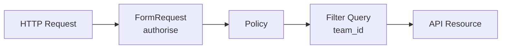

# Security Engineering Standards

**The engineering contract for changes to this Laravel JSON API starter.**

| Item             | Detail                                                                        |
| ---------------- | ----------------------------------------------------------------------------- |
| Document Version | 1.0.0                                                                         |
| Last Reviewed    | 19 November 2026                                                              |
| Scope            | This repository: the API, its authentication and sessions, and its CI tooling |
| Owner            | Ben Belmour, Engineering                                                      |

This page is the engineering contract: the rules every endpoint and change is expected to
follow. It describes **what ships in this starter**, not what a product built on top might
add later. Features such as authenticator-app TOTP, SMS codes, Passkeys, step-up
authentication, impersonation, organisation-level tenancy, and a browser SPA are **not**
shipped here. The [Current Exceptions](#current-exceptions) section names them so a
reviewer does not assume a control that is absent.

> [!NOTE]
> When a rule and a shipped limitation disagree, the limitation is named under
> [Current Exceptions](#current-exceptions). Do not treat a documented limitation as
> permission to add a second one.

## Purpose

This repository is a starter template, not a finished product. Its value is the pattern:
invokable controller, one FormRequest, an Action or Query class, a Policy, and an API
Resource, with tests that prove the allow and deny paths. A one-off route that skips the
pattern is a defect, not a shortcut.

The API is server-rendered JSON only. There is no first-party browser application holding
business rules, so no client-side check is ever counted as a control. The only human-facing
documents are the welcome page, the authenticated Scalar reference, and the RFC 9116
security.txt file.

## Threat Model Boundary

State the boundary before the controls, so a reviewer knows what this page claims and
what it does not.

The controls documented here protect the application and the data inside it against:

- **Credential attacks:** password guessing, credential stuffing, and reuse of breached
  passwords (Argon2id, the Have I Been Pwned check, the 12-character minimum, and the
  login rate limiters)
- **Privilege escalation through the API:** a caller exercising an ability it was not
  granted (Policies, permission checks, and `403 Forbidden` for denials)
- **Session theft and fixation:** session hijacking, replay, and fixation (identifier
  rotation at sign-in, the `session_version` stamp, the session registry, forced sign-out
  on password reset, suspension, and force-logout)
- **Team data exposure:** one Team reading another Team's directory rows (permission,
  Policy, and row scoping, all enforced server-side)
- **Script injection and clickjacking:** cross-site scripting and framing on the rendered
  pages (CSP, `X-Frame-Options`, and `nosniff`)
- **Dependency risk:** a known-vulnerable package reaching a merge (two blocking audits
  plus Semgrep on every change)
- **SSRF through webhooks:** an endpoint pointed at a private address, including a
  hostname that changes after registration
- **Log flooding through anonymous reports:** a CSP report POST carrying thousands of
  tiny reports

The same boundary defines what is out of scope:

- **Network volumetric attacks** such as DDoS absorbed at the edge: handled upstream of
  the application, not by any control on this page
- **Physical security and compromise of an account holder's device:** the server cannot
  defend the machine a person signs in from
- **Insider misuse by a genuinely privileged account:** Admin actions are recorded in the
  append-only audit trail for investigation, which makes the trail a detective control,
  not a preventive one
- **Deployment hardening:** TLS termination, secret storage, database backups, log
  shipping, and host patching are the deployer's responsibility
- **Anything the client could enforce on its own:** the API publishes no client code with
  business rules

Where a control is detective rather than preventive, the section below says so.

## Reviewer Map

This page is the contract; [platform-assurance.md](platform-assurance.md) is the measured
evidence. Test and coverage figures live in [testing.md](testing.md) so they do not drift
here.

| Review Theme                            | This Page                                                                          | Evidence                                                                                        |
| --------------------------------------- | ---------------------------------------------------------------------------------- | ----------------------------------------------------------------------------------------------- |
| Admin versus self-service access        | [Access Control](#access-control)                                                  | [permissions.md](permissions.md), [platform-assurance.md](platform-assurance.md)                |
| Team row scoping                        | [Team Row Scoping](#team-row-scoping)                                              | [permissions.md](permissions.md), [UserFilterQuery](../app/Queries/Users/UserFilterQuery.php)   |
| Authentication, MFA, and permissions    | [Authentication and MFA](#authentication-and-mfa), [Access Control](#access-control) | [permissions.md](permissions.md), [platform-assurance.md](platform-assurance.md)                |
| Audit logging                           | [Logging and Audit](#logging-and-audit)                                            | [AuthAuditLogPolicy](../app/Policies/AuthAuditLogPolicy.php), [platform-assurance.md](platform-assurance.md) |
| Dependency and vulnerability management | [Dependency Management](#dependency-management)                                    | [.github/workflows/ci.yml](../.github/workflows/ci.yml), [platform-assurance.md](platform-assurance.md) |
| Automated security and testing gates    | [Automated Security and Testing Gates](#automated-security-and-testing-gates)      | [testing.md](testing.md), [ci.yml](../.github/workflows/ci.yml)                                 |
| Environments and releases               | [Environments and Releases](#environments-and-releases)                            | [releasing.md](releasing.md)                                                                    |
| API abuse controls                      | [API Abuse Controls](#api-abuse-controls)                                          | [rate-limiting.md](rate-limiting.md)                                                            |
| How to report a vulnerability           | [Vulnerability Reporting](#vulnerability-reporting)                                | [SECURITY.md](../SECURITY.md), [security.txt](../public/.well-known/security.txt)               |

## Secure Development

These rules apply to every change that accepts input, talks to the database, or returns
data to a client.

- **Validate on the Server:** Every endpoint has exactly one FormRequest. Read only
  validated input into a DTO. Do not trust query params, headers, or a client to enforce a
  rule.
- **Keep Secrets Out of Source:** Application code reads settings with `config()`, never
  `env()` outside config files. Live values come from the environment. Tests and fixtures
  must not introduce real credentials.
- **Bind Parameters:** Database access uses Eloquent or bound parameters. Search patterns go
  through [LikePattern](../app/Support/LikePattern.php) so wildcards cannot widen a query.
- **Do Not Leak Internals:** Responses go through an API Resource and
  [ApiResponse](../app/Support/ApiResponse.php). Errors must not return stack traces,
  secrets, or session identifiers to the client.
- **Encode for the Sink:** The rendered pages use Blade escaping. Session ids are never
  emitted on the session API.
- **Prefer Framework Primitives:** Laravel Sanctum for authentication, Spatie Laravel
  Permission for permissions, Policies for authorisation, FormRequests for validation.
  Custom crypto and ad-hoc ACL checks are a last resort.
- **No Client-Supplied Team Id:** The Team scope comes from the signed-in User, never from a
  request field the client can set.
- **Screen Outbound URLs:** Webhook targets go through
  [WebhookUrlGuard](../app/Services/Webhooks/WebhookUrlGuard.php) at create, update, and
  delivery time, and the HTTP client never follows redirects.
- **Bound Anonymous Input:** The CSP report receiver caps the body size and the number of
  reports it will log from one request.

## Access Control

Authentication answers who the caller is. Authorisation answers what they may do. Both are
server-side.

- Named permissions (`users.update`, `users.assign-role`, `users.suspend`,
  `sessions.revoke-any`, `audit-logs.list`, and the rest) are the source of truth. The
  matrix lives in [permissions.md](permissions.md) and is seeded by
  [RolesAndPermissionsSeeder](../database/seeders/RolesAndPermissionsSeeder.php). There
  are 34 named permissions.
- `FormRequest::authorize()` delegates to a Policy. A hidden button in a client is not a
  control.
- Privilege gates answer `403 Forbidden`, not a `422` field error. A role change needs
  `users.assign-role`, and suspension needs `users.suspend`. Self-role-change and
  self-suspension are refused.
- Roles (`Admin`, `Manager`, `User`, `Service`) are bundles of permissions, not a second
  authorisation system. A Service identity is a machine account: it authenticates with
  client credentials, never a password or mailbox.
- `audit-logs.list` is granted to Admin only at seed, and
  [AuthAuditLogPolicy](../app/Policies/AuthAuditLogPolicy.php) additionally rejects service
  accounts even if the permission is mis-assigned.
- `users.list-all` is the explicit exception that lists across Teams. It is a permission,
  not a query flag the client can invent.
- Self-service routes (`/api/me`, own password, own tokens, own sessions) are authenticated
  but are not Spatie strings; directory and admin operations are.

**Status Codes:** permission denials on a write return `403 Forbidden`. Out-of-scope rows
on a read return `404 Not Found`, so existence cannot be probed from a denied read.
Validation failures return the `422` envelope. Authentication failures return `401`.

**Source of Truth:** the Policy class for that resource, not a client screen.

## Team Row Scoping

The starter uses a shared database and scoped Teams, not organisation-level tenancy.
Isolation is row scoped: the query is limited to the caller's Team before optional filters
run, and that boundary is not a client-supplied id.

A directory request is authorised and scoped in this order:

1. **Permission:** The caller must hold the list or update permission for that resource.
2. **Policy:** The Policy decides whether this User may see or change this row.
3. **Filter Query:** [UserFilterQuery](../app/Queries/Users/UserFilterQuery.php) binds
   `users.team_id` to the viewer's Team before optional filters run. A request may narrow
   the set. It must not widen it.

At seed, Admins see every Team (`users.list-all`); Managers see their own Team only; Users
cannot list users at all; Service identities list across Teams. The role matrix is the
contract, not a client convention.

The auth audit trail is a second documented exception: listing is Admin only
(`audit-logs.list`) and is not Team-scoped. Do not add Team scoping there as a "fix";
Admins are not meant to list another Team's trail.

**Source of Truth:** [UserFilterQuery](../app/Queries/Users/UserFilterQuery.php),
[UserQueryConstraints](../app/Queries/Users/UserQueryConstraints.php), and
[permissions.md](permissions.md).

## Authentication and MFA

- Passwords are hashed with Argon2id (`config/hashing.php`: 64 MiB, 4 iterations) and
  rejected if they appear in the Have I Been Pwned corpus. The minimum length is 12, with
  mixed case and numbers required, and a length cap so a hostile long input is refused
  before hashing.
- Login accepts a password and issues a Sanctum Personal Access Token. The default token
  expiry and the maximum lifetime are configuration (`config/api.php`), not code.
- Cookie sessions are supported alongside bearer tokens for same-origin clients. The
  session cookie takes the `__Host-` prefix when it is `Secure`, host-only, and scoped to
  `Path=/` ([SessionCookieName](../app/Support/SessionCookieName.php)).
- Session identifiers rotate at sign-in. A global `session_version` stamp invalidates
  sessions on password reset, suspension, and force-logout. Account holders can list and
  revoke devices (Active Sessions).
- Remember-me is shipped: a login may opt into a long-lived remember token, which is
  rotated and can be restored through `POST /api/auth/login/remember`.
- E-mail verification gates the business routes. The identity endpoints (`resend`,
  `logout`, `me`) sit outside that gate so an unverified account can still verify and sign
  out. Service accounts pass: they authenticate with client credentials and have no
  mailbox.
- Two-factor authentication is **email OTP, opt-in per account**: it applies when
  `mfa_method` is set. The code defaults to a 300-second lifetime and at most 5 attempts
  (`config/api.php`), and is carried by a stateless pending token. Send, verify, and status polling each have their own
  limiter. There is **no** authenticator-app TOTP, SMS, Passkey, social sign-in, or
  step-up re-authentication in this starter.
- Machine clients use the OAuth2 client-credentials grant
  (`POST /api/oauth/token`). Invalid credentials return the RFC 6749 `400` error body, not
  a validation envelope.
- Password reset is enumeration-neutral and rotates every credential on success.

## Logging and Audit

Security-relevant actions write to append-only `auth_audit_logs` through
[RecordAuthAuditLog](../app/Listeners/RecordAuthAuditLog.php). Writes are queued so sign-in
is not delayed on GeoIP or mail.

The trail covers sign-in, sign-out, 2FA, password change and reset, registration, session
revoke, token and API-client lifecycle, webhook endpoint lifecycle, role changes, and User
suspension. Named events live in
[AuthAuditEvent](../app/Enums/AuthAuditEvent.php) (34 events). The outcome is recorded
(`success`, `failed`, `refused`) and the row carries the request id, IP, parsed user agent,
and approximate city and country.

Listing (`GET /api/audit-logs`) requires `audit-logs.list`, granted to Admin only at seed.
The Policy also rejects service accounts. Application logs must not record passwords, OTP
codes, reset tokens, or session ids.

**Retention:** this starter ships no `auth_audit_logs` prune command. The only scheduled
pruner is `sanctum:prune-expired` for expired tokens. Audit retention is a deployment
decision; see [Current Exceptions](#current-exceptions).

## Dependency Management

- PHP and JavaScript dependencies are locked (`composer.lock`, `package-lock.json`). Live
  environments install those exact versions. Do not commit a `vendor` tree.
- `composer audit` and the production-only `npm audit` run on every proposed change and
  block merge if they fail. Semgrep scans application code on the same pipeline.
- Version gates keep the PHP floor, the runtime, the services, and the application version
  in sync (`verify:php-version`, `verify:php-cve-floor`, `verify:service-parity`,
  `verify:version`).
- Dependabot and Renovate propose updates through the same review and test cycle as any
  feature. Do not merge a dependency bump that skips CI.
- Base images are pinned by digest, and every third-party GitHub Action is pinned to a full
  commit SHA with the tag kept as a comment. Zizmor audits the workflow files.
- Do not add a package without a lockfile entry and a reason it is trusted.

## Environments and Releases

Environments are identifiers: `local`, `testing`, and CI. This repository ships **no**
staging or production deploy workflow. A deployment is the operator's responsibility, and
the controls below are the ones the repository can prove.

| Concern      | Rule                                                                                                                              |
| ------------ | --------------------------------------------------------------------------------------------------------------------------------- |
| PHPUnit      | Uses the dedicated `testing` MySQL database only. Do not point it at a development database.                                       |
| Local        | Sail with MySQL and Valkey; seeded demo data.                                                                                     |
| CI           | Native PHP 8.5 with a MySQL service container and Redis for the OpenAPI example job. No Sail in CI.                                |
| Secrets      | Environment-supplied. Version control holds non-secret defaults in `.env.example` and `.env.ci` only; `.env` is ignored.          |
| Release      | A tag is cut only from a commit whose **All Quality Gates** run is green. The procedure is [releasing.md](releasing.md).          |
| Deploy       | Not in this repository. A consumer must add its own deployment, TLS, backups, and secret management.                               |

## Automated Security and Testing Gates

A change cannot merge unless every independent CI job in
[.github/workflows/ci.yml](../.github/workflows/ci.yml) passes. The summary job,
**All Quality Gates**, fails when any of the 13 jobs fails, is cancelled, or is skipped.

| Gate                     | What It Proves                                                                 |
| ------------------------ | ------------------------------------------------------------------------------ |
| Pint                     | Formatting and the application version sync                                   |
| Link Check               | Every relative link and heading anchor in Markdown resolves                   |
| Frontend Build           | The Vite build succeeds on the pinned Node line                               |
| Larastan (Level 10)      | Maximum static analysis, with strict and deprecation rules                    |
| PHPUnit + Coverage       | The suite passes and line coverage over `app/` stays at or above 90%          |
| Security Audit           | `composer audit` and production-only `npm audit` find no advisories           |
| OpenAPI Examples         | Every documented example replays against a served, seeded app                 |
| Semgrep                  | No insecure PHP, Laravel, or GitHub Actions pattern                           |
| Zizmor                   | Workflow supply-chain policy (SHA pins, permissions, dangerous triggers)      |
| Hadolint                 | The Dockerfile lint, with named exceptions in `.hadolint.yaml`                |
| Base Image References    | Every `FROM` and `COPY --from` is digest-pinned and resolves                  |
| ShellCheck               | Every tracked shell script lints                                              |
| Lint Workflows           | `actionlint` and the runner-label lint                                        |

At v4.0.2 the suite ran **1,465 tests** with **93.11%** line coverage (5,472 of 5,877
statements) against the 90% floor. Current figures are in [testing.md](testing.md).

Product behaviour that is security-sensitive (permission deny paths, Team scoping, MFA,
session revoke, SSRF refusal) needs feature tests, not only a happy-path check.

## Browser and Transport Protections

Every response goes through [SecurityHeaders](../app/Http/Middleware/SecurityHeaders.php):

- `X-Frame-Options: DENY` and `X-Content-Type-Options: nosniff`
- `Referrer-Policy: strict-origin-when-cross-origin`
- `Permissions-Policy` denying camera, microphone, geolocation, and browsing topics
- `Cross-Origin-Opener-Policy: same-origin` and
  `Cross-Origin-Resource-Policy: same-origin`
- `Strict-Transport-Security` on TLS, `staging`, and `production`
- A Content Security Policy (enforced by default; `SECURITY_CSP_ENFORCE=false` switches to
  report-only)
- `Reporting-Endpoints` and the legacy `Report-To` header pointing at `/api/csp-reports`
- `Cache-Control: no-store, private` on responses carrying the CSP

The strict policy serves JSON responses. The Scalar page uses a separate
`csp_docs_policy` that allows the jsDelivr bundle and inline styles for the reference UI.
No nonce is minted because no served page runs an inline script of ours; the docs page is
the exception and is explicitly scoped.

CORS is an explicit allow-list ([config/cors.php](../config/cors.php)): named request
headers, the rate-limit headers exposed for cross-origin clients, and no wildcard with
credentials. The application refuses to boot with a CORS configuration that reflects any
origin while allowing credentials.

The client IP comes from [TrustedProxies](../app/Support/TrustedProxies.php), never from an
untrusted `X-Forwarded-For`. The list is read from the process environment before `.env` is
loaded, so a deployment must export it; see [Current Exceptions](#current-exceptions).

`GET /api/docs` and `GET /api/openapi.yaml` require `auth:sanctum` and carry a
`throttle:60,1` limiter in every environment. There is no public or Basic-Auth docs mode.

## API Abuse Controls

Seventeen named limiters guard the API ([AppServiceProvider](../app/Providers/AppServiceProvider.php),
[config/api.php](../config/api.php)). The main ones:

- **Login:** 5 per minute per e-mail plus IP, a 10 per minute per-account bucket keyed on
  the e-mail alone, and a 20 per minute per-IP ceiling.
- **Registration:** 5 per minute per e-mail plus IP, with a 10 per minute per-IP ceiling.
- **Two-factor:** 5 per minute send and verify (20 per-IP ceiling), 60 per minute status
  polling.
- **Password change and session revoke:** 5 per minute per User plus IP, with a 15 per
  minute per-IP ceiling each.
- **Tokens and webhooks:** 10 per minute per caller.
- **Client credentials:** 5 per minute per `client_id` plus IP, with a 20 per minute
  ceiling.
- **Public status, health, e-mail verification, CSP reports:** their own per-IP ceilings.

Rate-limit counters live in the configured cache store. A multi-instance deployment needs a
shared store (Redis or the database cache); the `array` store used by the PHPUnit suite
proves only per-process behaviour.

The CSP report receiver
([LogCspReportAction](../app/Actions/CspReports/LogCspReportAction.php)) caps the body at
16 KiB and logs at most 16 reports per request, then records one truncation row. Reports go
to the dedicated `csp-reports` log channel, never the main log.

Webhook delivery re-screens the target immediately before each send, refuses redirects, and
counts a failed screen as a delivery failure. The residual race between the screen and the
HTTP client's own DNS lookup is documented under exceptions.

## Vulnerability Reporting

External researchers report issues privately, not through a public GitHub issue. The path
is published in two places:

- [SECURITY.md](../SECURITY.md) (the GitHub Security policy)
- [security.txt](../public/.well-known/security.txt), served at
  `/.well-known/security.txt` by
  [ShowSecurityTxtController](../app/Http/Controllers/WellKnown/ShowSecurityTxtController.php)

The current contact is this repository's GitHub private vulnerability reporting form. There
is no bounty. The policy aims to acknowledge reports within two business days and to agree
a fix timeline based on severity. `Expires` in `security.txt` must stay within one year;
the test suite fails when it goes stale.

Do not invent a second contact in docs or in `security.txt`. If the alias changes, update
`SECURITY.md` and `security.txt` together.

## Current Exceptions

These are documented so a reviewer is not surprised, and so a later change can close them
rather than copy them.

| Topic                    | Current Behaviour                                                                                                                 | Why It Is Named                                                                 |
| ------------------------ | --------------------------------------------------------------------------------------------------------------------------------- | ------------------------------------------------------------------------------- |
| MFA channels             | E-mail OTP only, opt-in per account (`mfa_method`). No authenticator-app TOTP, SMS, Passkeys, or social sign-in.                  | The starter ships one channel; a product adds the rest behind the same contract. |
| Step-up authentication   | Not shipped. A fresh re-authentication proof is not required before sensitive writes.                                             | Sessions and policies are in place; the proof flow is a product decision.       |
| Impersonation            | Not shipped.                                                                                                                      | A signed, auditable impersonation session is a product feature, not a starter.  |
| Tenancy                  | Team row scoping, not organisation-level tenancy.                                                                                 | The starter demonstrates one boundary; a product may add a second scope.        |
| Audit retention          | No `auth_audit_logs` prune command. Only expired Sanctum tokens are pruned on a schedule.                                         | Retention is a compliance decision per deployment.                              |
| Trusted proxies          | Read from the process environment before `.env` is loaded; a value written only to `.env` is ignored.                             | `bootstrap/app.php` resolves the list before the config binding exists.       |
| Webhook SSRF             | Re-screened at delivery time, but the screen and the HTTP client resolve DNS separately, so a narrow rebinding race remains.      | Closing it means pinning the screened IP into the client.                       |
| CSP nonce                | No nonce is minted; no first-party inline script exists. The Scalar page uses its own policy with inline styles and jsDelivr.     | A nonce would be dead header bytes on JSON responses.                           |
| App info                 | `GET /api/app-info` publishes the app name, environment, PHP/Laravel versions, and driver names publicly.                         | A deploy check needs it; versions are already inferable from the runtime.       |
| Deployment               | No staging or production workflow ships. TLS, backups, secret storage, and host hardening are the operator's responsibility.     | The repository is a starter, not a deployment product.                          |
| Browser testing          | No SPA and no Playwright suite. The API contract and the rendered Scalar page are covered by PHP tests.                           | The starter has no first-party browser application to drive.                    |
| Rate-limit store         | Counters are correct only with a shared cache store across instances; the test suite uses `array`.                                | The example env uses Redis; a deployment must keep it.                          |
| Demo client credentials  | A demo API client and secret are seeded for local exploration.                                                                    | Rotate or remove them in any deployment.                                        |

## What This Page Is Not

- It is not a replacement for [platform-assurance.md](platform-assurance.md). That document
  is the measured story for reviewers. This page is the engineering contract.
- It is not an information-security policy, staff handbook, or incident-response plan.
- It does not claim features the starter does not ship. Authenticator apps, Passkeys,
  step-up, impersonation, organisation tenancy, a browser SPA, and a deployment pipeline
  are named as absent above.
- It does not cover the operator's environment: TLS termination, secret managers, backups,
  log shipping, and host patching belong to the deployment.

If a future control needs a real policy (retention periods, incident SLAs, staff access
reviews), add that as its own document. Do not grow this page into a policy pack by stealth.

## Related Documents

| Doc                                                              | Use                                                        |
| ---------------------------------------------------------------- | ---------------------------------------------------------- |
| [platform-assurance.md](platform-assurance.md)                   | What ships today, with measured evidence                   |
| [SECURITY.md](../SECURITY.md)                                    | Responsible disclosure contact and response targets        |
| [permissions.md](permissions.md)                                 | Permission and role matrix                                 |
| [rate-limiting.md](rate-limiting.md)                             | Limiters, key shapes, counter storage                      |
| [testing.md](testing.md)                                         | How to run the gates locally                               |
| [releasing.md](releasing.md)                                     | Release gates, tag, and GitHub release                     |
| [branch-hygiene.md](branch-hygiene.md)                           | Branch and Dependabot handling                             |
| [openapi.yaml](openapi.yaml)                                     | Consumer-agnostic API contract                             |
| [.github/workflows/ci.yml](../.github/workflows/ci.yml)          | Blocking merge checks                                      |
